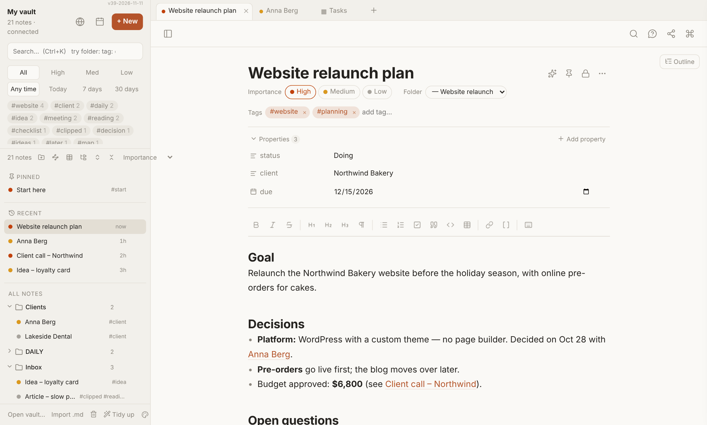
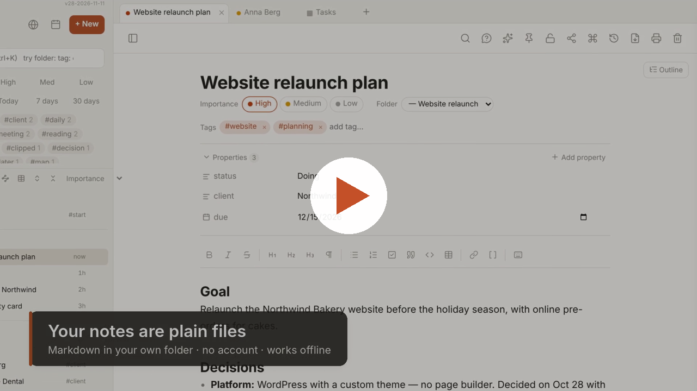

# My Notes

A calm, fast notes app for your own computer. Your notes are plain **Markdown files** in a folder you choose. No account, no server, no lock-in.

**▶ [Open My Notes](https://rudivanek.github.io/My_Notes/)** (Chrome or Edge) · [Manual](Manual/My%20Notes%20Manual.md) · [What's new](CHANGES.md) · [Sample vault (zip)](https://github.com/rudivanek/My_Notes/raw/main/My-Notes-Sample-Vault.zip)

*1-minute intro video (made with an earlier version; a few buttons have moved since).*

---

## Why

- **Your files, your folder.** Every note is an ordinary `.md` file. Open it in any editor, sync it with Dropbox / OneDrive / iCloud, back it up however you like.
- **Simple on the surface.** One clean window: notes, folders, tabs, search. The rest is there when you need it.
- **Works offline.** Install it as an app from Chrome or Edge; after that it runs without internet.
- **Compatible with Obsidian vaults**, but doesn't need Obsidian (see [My Notes and Obsidian](#my-notes-and-obsidian)).

## What it can do

- **Writing:** Markdown with live formatting, `[[links]]` between notes, backlinks, images, outline, daily notes with templates
- **Organising:** folders, an Organize page with drag & drop, pins, icons, importance, tags, properties
- **Finding:** forgiving search with grouped results, narrowing words (`folder:` `tag:` `edited:7d` `status:Doing` …), saved searches, jump to a note (Ctrl+O), command palette with every action (Ctrl+Shift+A)
- **Tables like Notion:** columns with dropdowns, dates, checkboxes and note links; every row is a note; filters and saved views; send any note to a table
- **Maps:** mind maps and idea boards made of cards and arrows, stored as plain text
- **Graph** of how your notes link together
- **Locked notes:** AES-256 encrypted, one password for all
- **Version history** and a **Trash** you can restore from
- **Optional AI (Claude, with your own key):** ask questions about all your notes with sources; ask anything about one note or a selected paragraph; your own AI buttons (summarize, checklist, translate…); tag and folder suggestions; turn a note into a map
- Print and PDF, web clipper, open `.md` files from the desktop, quick capture, themes and fonts

## My Notes and Obsidian

My Notes is a lightweight **Obsidian alternative** for people who want something simpler. Your vault works in both: you can open the same folder in My Notes and in Obsidian, even side by side.

**The same in both**
- Plain Markdown files in your own folder, with `[[links]]`, backlinks, tags and properties (YAML front matter)
- Bases (`.base` files) and callouts
- No lock-in: stop using either app at any time and your notes stay as they are

**Different in My Notes**
- **Nothing to install:** it runs in Chrome or Edge, or install it as an app with one click
- **Built in, no plugins needed:** tables like Notion, mind maps, locked (encrypted) notes, version history, Trash, web clipper, PDF
- **AI built in** with your own Claude key: ask your notes, ask about a note or a paragraph, your own AI buttons
- **Fewer settings on purpose:** one calm window, the rest is in the command palette

**Where Obsidian does more:** a huge plugin and theme community, mobile apps, its own sync and publish services, Canvas and many advanced features. If you rely on those, keep Obsidian; you can still use My Notes on the same vault.

### Using the same vault in Obsidian

Your notes stay ordinary Markdown files, so the core of your vault works in Obsidian. Only the My Notes extras look different there, because Obsidian doesn't know how they are stored.

**Works the same in both**
- Notes, folders, headings, checkboxes and formatting
- `[[links]]`, `![[images]]`, linked PDFs and other files, backlinks; Obsidian's graph shows the same connections
- Tags (also nested) and properties, including the importance level
- Links to files on your PC (`file:///…`) — Obsidian can even open them directly
- The `Related: [[…]]` lines the graph adds and the `🗺 Map: [[…]]` line under a note turned into a map
- Trash: both apps use the same `.trash` folder

**Works in Obsidian, without the My Notes extras**
- **Maps** show as normal notes: card text, `→` arrow lines and a `map-layout` property with the card positions. Everything is readable, there's just no map view.
- **Tables** open as Obsidian Bases (each row is a note, each cell a property). Coloured choices, column types and saved filter views only show in My Notes. *Not tested yet:* changing a table's columns in Obsidian may remove the My Notes column settings — try it on a copy first.
- **Pins, icons, saved searches and sort order** are kept in `My Notes/settings.md`, which Obsidian ignores.

**Only in My Notes**
- **Locked notes** look like scrambled text in Obsidian and can't be opened there. ⚠️ **Never edit a locked note in Obsidian** — changing even one character breaks it and it can no longer be unlocked.
- **Version history** is kept in the hidden `.history` folder; Obsidian doesn't show it.
- AI features, the command palette, search words like `tag:` or `edited:`, drag-to-link in the graph, and printing are part of the app, not of your files.

**In short:** you can open your vault in Obsidian at any time and lose nothing important — just leave locked notes alone there.

*My Notes is an independent project. It is not affiliated with or endorsed by Obsidian.*

## Get started

You need **Google Chrome** or **Microsoft Edge** on a computer (Windows, Mac, Linux, ChromeOS). Only these browsers let a web app read and write a folder on your disk. Firefox and Safari can only run the demo.

### Option A: online (easiest)
1. Open **https://rudivanek.github.io/My_Notes/** in Chrome or Edge.
2. Click the **Install** icon at the right end of the address bar → **Install** (optional, but then it works offline and has its own window).
3. Click **Open vault…** (bottom left) and choose your notes folder. Allow the browser to edit files there.

Your notes don't go to that website. The page is only the app; it reads and writes the folder on your own computer.

### Option B: from this folder (fully offline)
Download this repository ([Code → Download ZIP](https://github.com/rudivanek/My_Notes/archive/refs/heads/main.zip)), unzip it, and keep the folder somewhere permanent (not inside your notes folder).

| System | Start it with | Then |
| --- | --- | --- |
| Windows | double-click **Install My Notes.bat** | Chrome opens `http://localhost:47123/` → click **Install** in the address bar → close the black window |
| Mac | double-click **Start My Notes.command** (first time: right-click → Open) | same as above; needs Python 3 (macOS offers to install it) |
| Linux | `sh start-my-notes.sh` | open `http://localhost:47123/` in Chrome → **Install**; needs Python 3 |

The small server only runs while installing or updating, and only your own computer can reach it.

### Try the sample vault
The folder **[Sample Vault](Sample%20Vault)** (also as a [zip](https://github.com/rudivanek/My_Notes/raw/main/My-Notes-Sample-Vault.zip)) holds made-up notes for "Northwind Bakery" with a table, a map, daily notes, a template and the whole manual. In My Notes click **Open vault…**, choose the Sample Vault folder and start with the pinned note **Start here**.

## AI (optional)

AI features use [Claude](https://www.anthropic.com/) with **your own API key** from [console.anthropic.com](https://console.anthropic.com/). The key is stored only in your browser on that computer. Notes are sent to Anthropic only when you use an AI feature, only what that feature needs, and **locked notes are never sent**. Costs go to your own Anthropic account (a fraction of a cent to a few cents per use).

## Privacy

My Notes has no server and no account. It reads and writes your notes folder directly. Nothing is uploaded, except when you use an AI feature (to Anthropic, with your key) or the web clipper (the page address to [Firecrawl](https://www.firecrawl.dev/), with your key).

## Manual

Everything is explained in the **[My Notes Manual](Manual/My%20Notes%20Manual.md)**: install, writing, organising, search, tables, maps, locked notes, AI, shortcuts, right-click menus and troubleshooting. The same manual is in the Sample Vault, so you can read it inside the app.

## Files in this repository

| File / folder | What it is |
| --- | --- |
| `index.html` | the whole app (one file) |
| `sw.js`, `manifest.webmanifest`, `icon-*.png` | make it installable and work offline |
| `Install My Notes.bat`, `serve.ps1` | Windows starter (tiny local server) |
| `Start My Notes.command`, `start-my-notes.sh` | Mac / Linux starter |
| `Manual/` | the manual, its screenshots and the intro video |
| `Sample Vault/`, `My-Notes-Sample-Vault.zip` | a sample vault to try everything |
| `CHANGES.md` | what changed in each version |
| `VERSION.txt` | the current version |

## Problems and ideas

Please open an [issue](https://github.com/rudivanek/My_Notes/issues). Mention your version (tiny text at the top right of the sidebar), your browser and your system.

## License

[MIT](LICENSE). My Notes includes open-source libraries under their own licenses; see [THIRD-PARTY-NOTICES.md](THIRD-PARTY-NOTICES.md).
