---
tags:
  - help
  - manual
importance: medium
---
# My Notes — User Manual

**My Notes** is a calm, fast notes app for your own computer. Your notes are ordinary **Markdown (`.md`) files** in a folder you choose, called your **vault**. My Notes reads and saves those files directly. Nothing goes to a server, there is no account, and your notes stay readable in any other text editor.

On top of plain notes, My Notes gives you tables like Notion, mind maps, a link graph, locked (encrypted) notes, version history, and optional AI help from Claude.

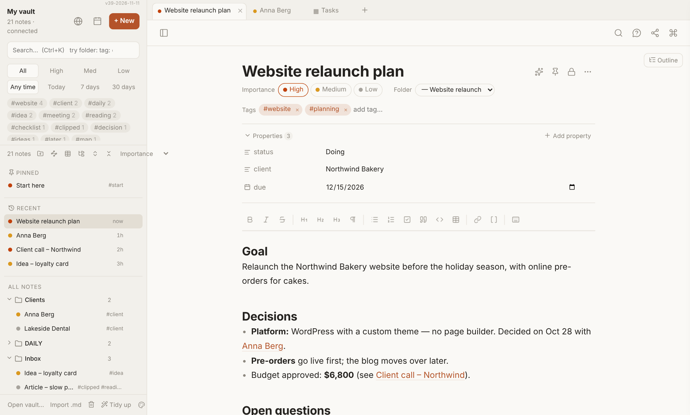

*This manual is for version v58 (November 2026). Read it inside the app any time: **Manual** at the bottom left of the sidebar (or the command palette: *Open the manual*). The version number shows in tiny text at the top right of the sidebar. What changed in each version: see `CHANGES.md` in the app folder.*

### Intro video (1 minute)
[▶ Watch the intro video](https://rudivanek.github.io/My_Notes/Manual/My%20Notes%20-%20intro.mp4) (63 seconds, no sound). It was made with version 28, so a few buttons have moved since then: the note buttons now sit next to the note title (see [The screen](#2-the-screen)). The video file is also in the app's folder on GitHub: `Manual/My Notes - intro.mp4`.

---

## Contents

**Part 1 — The basics**
1. [Install and first start](#1-install-and-first-start)
2. [The screen](#2-the-screen)
3. [Writing notes](#3-writing-notes)
4. [Organising: folders, pins, icons, importance, tags, properties](#4-organising)
5. [Finding things](#5-finding-things)
6. [The command palette](#6-the-command-palette)

**Part 2 — More kinds of notes**

7. [Tables (like Notion)](#7-tables-like-notion)
8. [Bases (saved views of notes)](#8-bases-saved-views-of-notes)
9. [Maps (mind maps and idea boards)](#9-maps-mind-maps-and-idea-boards)
10. [Graph: how your notes link to each other](#10-graph)
11. [Daily notes and templates](#11-daily-notes-and-templates)
12. [Images, attachments and links to files](#12-images-attachments-and-links-to-files)
13. [Web clipper](#13-web-clipper)

**Part 3 — Keeping things safe**

14. [Locked notes](#14-locked-notes)
15. [Version history](#15-version-history)
16. [Trash](#16-trash)

**Part 4 — AI (optional)**

17. [Setting up AI, privacy and costs](#17-setting-up-ai-privacy-and-costs)
18. [Suggestions and Tidy up](#18-suggestions-and-tidy-up)
19. [Ask your notes](#19-ask-your-notes)
20. [AI on selected text and AI boxes](#20-ai-on-selected-text-and-ai-boxes)
21. [Turn a note into a map](#21-turn-a-note-into-a-map)

**Part 5 — Everything else**

22. [Printing and PDF](#22-printing-and-pdf)
23. [Using several PCs (Dropbox)](#23-using-several-pcs-dropbox)
→ [My Notes on your phone](#my-notes-on-your-phone)
24. [Windows: opening .md files and quick capture](#24-windows-opening-md-files-and-quick-capture)
25. [Appearance](#25-appearance)
26. [Keyboard shortcuts](#26-keyboard-shortcuts)
27. [Right-click menus](#27-right-click-menus)
28. [Where your data lives](#28-where-your-data-lives)
29. [Troubleshooting and questions](#29-troubleshooting-and-questions)

**[How do I…? — quick answers](#how-do-i)**

---

## How do I…?

| I want to… | Do this |
| --- | --- |
| Read this manual inside the app | **Manual** at the bottom left |
| Make a new note | **+ New**, or **Ctrl+Alt+N** |
| Open a note quickly by name | **Ctrl+O**, type part of the name, Enter |
| Find a word in all notes | **Ctrl+K** and type |
| Find notes edited this week in one folder | Search `folder:Projects edited:7d` |
| Link two notes | Type `[[` and pick the note |
| Move a note | Drag it onto a folder, or change **Folder** at the top of the note |
| Move a folder | Right-click it → **Move folder to…**, or drag it onto another folder |
| Rearrange lots of notes and folders | **org** above the note list → the Organize page |
| Let AI suggest a tidier folder structure (and undo it) | **Organize** at the bottom left → [Organize vault](#organize-vault-ai-suggests-you-decide) |
| Keep a note at the top | **Pin** button next to the note title (or **⋯** → Pin) |
| Protect a password or private note | **Lock** button next to the note title (or **⋯** → Lock note…) |
| Get an old version back | **⋯** next to the note title → **Version history** |
| Undelete a note | Trash icon (bottom left) → **Restore** |
| Delete many rows of a table | Tick them at the left → **Delete** in the bar above |
| Make a to-do table | **table** button above the note list |
| Add a note to a table | **⋯** next to the note title → **Send to a table…** → choose the table → **Send** |
| Draw a mind map | **map** button above the note list |
| See all commands | **Ctrl+Shift+A** |
| Ask a question about my notes | **Ctrl+J** (needs AI) |
| Select a whole paragraph | **Triple-click** it (double-click selects a word) |
| Summarize or translate a paragraph | Triple-click it to select it, click the **✨** that appears (needs AI) |
| Ask anything about the whole note | **✨** next to the note title → **Ask** row (needs AI) |
| Make my own AI button | **✎** after the AI buttons, or **☆ Save as button** after a question |
| Choose Claude, OpenAI or DeepSeek | Robot icon at the bottom left of the sidebar (**AI settings**) |
| Chat with AI inside a note | Select the text, click **✨**, ask; continue with **Reply**, finish with **Summarize**, see [AI on selected text](#20-ai-on-selected-text-and-ai-boxes) |
| Save a note as PDF | **Ctrl+Shift+P** |
| Get changes from my other PC right now | Right-click **All notes** → **Check for changes on disk** |

---

# Part 1 — The basics

## 1. Install and first start

### What you need
- **Google Chrome** or **Microsoft Edge** on a computer (Windows, Mac, Linux or ChromeOS). Only these browsers let a web app read and write a folder on your computer. In Firefox and Safari My Notes only runs as a demo.
- A folder for your notes (your **vault**). To try things first, use the **Sample Vault** that comes with the app.

There are two ways to run My Notes. Both give you the same app; pick one.

### Option A: open it online (easiest, any system)
1. In Chrome or Edge, go to **https://rudivanek.github.io/My_Notes/**
2. Click the **Install** icon at the right end of the address bar → **Install**. My Notes gets its own window, Start-menu / Launchpad entry and taskbar / Dock icon, and works offline from now on.
3. Click **Open vault…** (bottom left), choose your notes folder (or the Sample Vault), and allow the browser to **edit** files there.

Your notes never go to that website: the page is only the app. It reads and writes the folder on your own computer. Updates arrive by themselves the next time you open the app while online.

### Option B: run it from the app folder (offline)
Download the app ([Code → Download ZIP](https://github.com/rudivanek/My_Notes/archive/refs/heads/main.zip) on GitHub), unzip it and keep the folder somewhere permanent, not inside your vault.

**Windows**
1. Double-click **Install My Notes.bat**. A black window opens, and Chrome opens My Notes at `http://localhost:47123/`.
2. Click the **Install** icon at the right end of Chrome's address bar → **Install**.
3. Close the black window. It's only needed for installing and updating.
4. In My Notes, click **Open vault…** and choose your notes folder.

**Mac**
1. Double-click **Start My Notes.command**. (The first time, macOS may say it's from an unidentified developer: right-click the file → **Open** → **Open**.) It needs Python 3; if it's missing, macOS offers to install it.
2. Chrome opens `http://localhost:47123/`. Click **Install** in the address bar.
3. Close the Terminal window, then **Open vault…** in My Notes.

**Linux**
1. In a terminal, in the app folder: `sh start-my-notes.sh` (needs Python 3).
2. Open `http://localhost:47123/` in Chrome, click **Install**, then close the terminal.

From now on, start My Notes like any other program.

> **Why the small server?** Chrome only lets you install an app from a web address. The script runs a tiny server that only your own computer can reach, and only while its window is open.

### The Sample Vault
The app comes with a folder **Sample Vault**: a few made-up notes for "Northwind Bakery" with a table, a map, daily notes, a template and this whole manual (in the folder *My Notes Manual*). Open it with **Open vault…** and start with the pinned note **Start here**. To get your own notes back, click **Open vault…** again and choose your folder. Using Option A? Download the sample vault as a zip: [My-Notes-Sample-Vault.zip](https://github.com/rudivanek/My_Notes/raw/main/My-Notes-Sample-Vault.zip).

### Your vault
Your vault is just a folder with `.md` files and sub-folders. My Notes can open an existing folder, for example an old Obsidian vault, or a new empty one. Every note is a file you can also open in Notepad, VS Code or any Markdown app.

### Reconnecting
Now and then, usually after a restart, Chrome asks again for permission to your vault. Click anywhere in My Notes (or **Reconnect**) and allow it. If Chrome offers **Allow on every visit**, choose that.

### Quick start
After the first time, My Notes opens almost instantly. It keeps a copy of your notes in Chrome's own storage on this PC and shows that copy right away. Then it checks your vault quietly: only files that changed since last time are read again, and notes deleted elsewhere disappear. While it checks, a small **Checking for changes…** pill shows at the bottom. It usually takes a few seconds.

You can start reading and typing straight away. Anything that saves to disk (typing, moving, new notes) waits until the check is done, so nothing is written to the wrong place. If a note was also changed on another PC in the meantime, you get both versions, as always: the newest one from disk, and yours as "(my version)".

The very first start, or a start after choosing another vault, still reads every file. This is now faster too, because many files are read at the same time.

### Updating to a new version
- **Option A (online):** nothing to do. Open My Notes while online; it updates itself and reloads.
- **Option B (app folder):** put the new files into the app folder, start it the same way as when you installed it (`.bat`, `.command` or `.sh`), open My Notes once (it reloads itself to the new version), then close the server window.

The version number at the top right of the sidebar tells you which version you're on.

---

## 2. The screen

- **Sidebar (left):** your vault's name, **+ New**, the **search box**, filters (importance, date, tags), and the note list: **Saved searches**, **Pinned**, **Recent**, then **All notes** with all your folders.
- **Tabs (top):** every note you open stays open in a tab. Click **×** to close one. Right-click a tab for more.
- **Note (centre):** title, importance, folder, tags, properties, the formatting bar, and the text.
- **Top bar (right):** buttons for the whole app — jump to a note (🔍), Ask your notes (💬), graph, command palette (⌘).
- **Next to the note's title:** the 3 note actions you use most (at first: ✨ AI suggestions, pin, lock) and **⋯** with everything else for this note — send to a table, version history, print, save as PDF, duplicate, move, delete… My Notes counts which actions you use (on this PC) and shows your top 3 there; it updates when the app starts, so the buttons don't move while you work. **⋯ → Customize buttons…** lets you tick actions that should always be shown. Tables have the same row of buttons in their header.
- **Bottom left:** Open vault…, Import .md, Trash, Tidy up, and the **Appearance** panel (palette icon).

**Sidebar width:** drag its right edge; double-click the edge to reset. **Hide the sidebar:** the panel button at the top left, or **Ctrl+\\**. **Ctrl+K** brings it back with the cursor in the search box.

**Outline:** long notes show an **Outline** button at the top right with all headings; click one to jump there.

---

## 3. Writing notes

### Create, rename, delete
- **New note:** **+ New**, **Ctrl+Alt+N**, or right-click a folder → **New note here**.
- **Rename:** click the title and type.
- **Delete:** the trash button at the top, the note's right-click menu, or its tab's right-click menu. Deleted notes go to the [Trash](#16-trash), so you can get them back.
- **Duplicate:** right-click the note → **Duplicate**.
- **Empty "Untitled" notes clean themselves up.** If you create a note and leave without typing anything, it's removed. To clear out old blank ones: right-click **All notes** (or a folder) → **Remove empty "Untitled" notes…** You see the list first.

### Saving
Saving is automatic. If a note was changed somewhere else (on your other PC, or in another editor), My Notes loads the newest version and never silently overwrites it. If you also had unsaved edits, they're kept in a separate note called *"… (my version)"*.

### Formatting
The formatting bar above the text has bold, italic, strikethrough, headings, normal text, bullet and numbered lists, checkboxes, quote, code, table, web link and note link. The text is Markdown underneath, so you can also type it directly (`**bold**`, `# Heading`, `- list`, `- [ ] task`).

| Shortcut | Does |
| --- | --- |
| Ctrl+B / Ctrl+I | Bold / italic |
| Ctrl+Shift+X | Strikethrough |
| Ctrl+E | Code |
| Ctrl+Alt+1 / 2 / 3 / 0 | Heading 1 / 2 / 3 / normal text |
| Ctrl+Shift+8 / 7 / 9 | Bullet list / numbered list / checkbox |
| Ctrl+Shift+. | Quote |
| Ctrl+Alt+T | Insert a table |
| Ctrl+K (in the text) | Web link |
| Ctrl+Shift+V | Paste as plain text |

Copied text with formatting (from Claude, a web page, Google Docs…) is turned into Markdown when you paste it: headings, bold, lists, links and **tables** come out as normal Markdown. The first row of a pasted table becomes its header row.

### Linking notes
- Type **`[[`** and pick a note from the list, e.g. `[[Website relaunch plan]]`. Or press **Ctrl+Shift+K**.
- Or **drag a note** from the sidebar into the text.
- Click a link to open that note. A link to a note that doesn't exist yet is shown faded; clicking it creates the note.
- Under each note, **Linked from** lists the notes that link to it, and **Links to** lists the notes it links to.
- Right-click a note → **Copy link** puts `[[Note name]]` on the clipboard.

---

## 4. Organising

### Folders
- **New folder:** the folder button above the note list, or right-click a folder → **New folder inside…**
- **Rename:** right-click → **Rename folder…**
- **Move a note:** drag it onto a folder, or pick another folder in the **Folder** box at the top of the note.
- **Move a folder:** right-click → **Move folder to…** and pick the new place (**Vault root** = top level). Or drag the folder onto another folder, or onto the **All notes** title. This works in search results too.
  - Everything inside moves with it: notes, sub-folders, tables and attachments. Pins, icons, folder sorting, version history and saved searches follow too, and links that contain the folder path are fixed.
  - If the target already has a folder with the same name, you choose: **merge** them (files with the same name become "name 2"; nothing is overwritten), or keep them separate under a new name.
- **Delete a folder:** right-click → **Delete folder**. It goes to the Trash with everything inside.
- **Expand / collapse all:** the two arrow buttons above the note list.

### The Organize page (big tree)

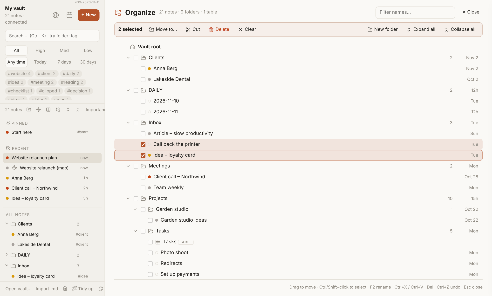
When the sidebar feels too narrow for a big cleanup, click **org** above the note list (or right-click **All notes** → **Organize folders and notes…**, or the command palette). The note area becomes one large tree of all your folders, notes and tables; the sidebar stays as it is.

- **Select:** click a row; **Ctrl+click** adds or removes one; **Shift+click** selects a range; or tick the small boxes. **Ctrl+A** selects everything shown.
- **Move by dragging:** drag a selected row onto a folder (or onto **Vault root**). The target is outlined and says "move N items here". Hold over a closed folder for a moment and it opens. All selected items move together; anything inside a selected folder simply moves with that folder.
- **Other ways to move:** **Move to…** (pick the folder from a list), or **Cut** (Ctrl+X), click the target folder, **Paste** (Ctrl+V).
- **Rename:** F2 or the **Rename** button. **New folder** creates one inside the folder you're on. **Delete** (Del) moves the selection to the Trash.
- **Undo:** every move and rename happens right away; the bar at the bottom says what happened and offers **Undo** (also **Ctrl+Z**). Deletions are undone from the Trash instead.
- **Filter names…** at the top shows only matching notes and folders (with the folders they're in).
- **Keyboard:** ↑/↓ move, → / ← open or close a folder, Space ticks, Enter opens a note (and leaves the page), **Esc** clears the selection, then closes the page.

### Organize vault (AI suggests, you decide)
When the whole vault needs a cleanup — several inboxes, duplicate folders, old projects lying around — click **Organize** at the bottom left of the sidebar (next to **Tidy up**), or the command palette: *Organize vault*.

1. **Choose how:** *Tidy what I have* (keep your folders; merge duplicates, gather loose inbox and scratch folders, archive what's old) or *PARA* (sort your top folders into Projects, Areas, Resources and Archive, reusing folders you already have). Optionally tell it what to keep in mind, e.g. *Leave SHARPEN.STUDIO alone*.
2. **Make a plan.** The AI sees only your **folder names, how many notes they hold, when they were last edited and a few note titles** — not the text of your notes. It returns a list of suggestions, each with a short reason. Folders with almost the same name (like *My Notes* and *My_Notes*) are found without AI and added to the list.
3. **Decide.** Tick or untick each suggestion. You can change any target folder — type a new name and it will be created. Suggestions that can't work (a folder that doesn't exist, a folder into itself) are shown greyed out with the reason. Tips (things to check by hand) are shown but never applied.
4. **Apply.** After one confirmation, the ticked changes run one after another with a progress line.

**Safe by design:**
- **Nothing is deleted.** Files are moved; a folder that ends up empty goes to the **Trash**.
- **Nothing is overwritten.** If the target already has a file with the same name, the moved one is kept as *name 2*.
- **Restore points.** Every single move is recorded as it happens, for every cleanup. **Undo this cleanup** (on the result screen, under *Earlier cleanups* on the Organize start screen, or the palette: *Undo the last vault cleanup*) puts every file back where it was — merges included — and brings back the emptied folders. Several cleanups are undone one after another, newest first. Cleanups made with v56–v57 whose restore point was replaced are rebuilt from the log note (their files go back; tables and links changed for them stay as they are).
- **Waits for Dropbox.** If Dropbox (or a virus scanner) is busy with a file or folder, it waits a moment and tries again, up to 6 times. If an emptied folder can't go to the Trash, the cleanup carries on and tells you, so you can delete the empty folder yourself.
- **Stops at the first real problem.** It tells you what went wrong; everything before it stays done, and you can undo it. If some files are still busy during **Undo**, it says so — click **Undo this cleanup** again later and it moves back only the ones that are left.
- **Links and tables follow.** Tables that look at a moved folder, and `[[folder/path]]` links in notes, are updated (and changed back by Undo). Pins, icons and open folders follow too.
- **A log.** The note **Vault organizer log** in the vault root lists every cleanup and undo, newest first, with every file that moved.

Tip: make a backup or let Dropbox finish syncing before a big cleanup — and close My Notes on your other PCs while it runs.

### Pins
Pin notes, folders and tables to the top of the sidebar: the **pin** button at the top, the pin that appears when you hover a row, or the right-click menu. **Drag pinned items** to put them in your own order.

### Icons and colours
Right-click a note, folder or table → **Change icon…** Choose a line icon or an emoji, and a colour. Icons follow the item when you rename or move it.

### Importance
Every note can be **High**, **Medium** or **Low**, set with the buttons under the title. It shows as a coloured dot, and you can filter and sort by it.

### Tags
Type in the **Tags** field under the title (Enter adds a tag). Tags written in the text, like `#idea`, count too. Click a tag in the sidebar to show only notes with that tag. Tags can be nested: `#project/website`.

### Properties
Open **Properties** under the title → **Add property** to store facts about a note: text, number, date, date & time, checkbox, list, tags or web address. The type you choose is remembered for that property name everywhere. Properties are saved at the top of the file and are searchable (see `status:Doing` below).

---

## 5. Finding things

### Search (Ctrl+K)
Type in the search box at the top of the sidebar. Results are grouped:

- **Recently opened:** matches you opened in the last two weeks
- **Titles:** note names and tables (marked TABLE)
- **Folders**
- **Found inside notes:** the text, tags or properties, with the matching line shown

Each group shows the first few results; **Show more** shows the rest. Every result shows its folder on the right.

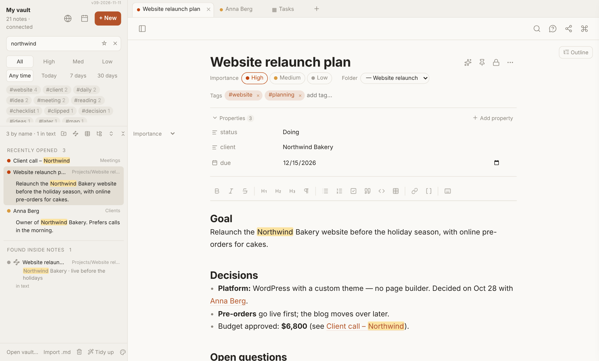

**Search is forgiving:** small typos still find the note ("websit relanch"), and so do word starts ("we re") and initials ("wrp"). Text search ignores accents. Put an exact phrase in "quotes".

**Narrowing words.** Combine as many as you like with normal words:

| Write | Finds |
| --- | --- |
| `folder:Projects` | notes in that folder and its sub-folders (`folder:root` = top level only) |
| `tag:idea` | notes with that tag (also nested tags) |
| `status:Doing`, `client:Northwind` | any property containing that value |
| `is:pinned` `is:locked` `is:map` `is:table` `is:empty` | special kinds of notes |
| `is:high` `is:medium` `is:low` | importance |
| `edited:7d` `edited:today` `opened:30d` | edited / opened within that time (d, w, m, y; also `yesterday`) |
| `-folder:Inbox` | a minus in front excludes |

While you type `folder:`, `tag:`, `is:` or `edited:`, a pick list appears at the top.

**Keyboard in the search box:** ↓/↑ move through results, **Enter** opens, **Ctrl+Enter** opens but stays in the search (handy for looking at several results), **Esc** clears the search and returns to your note.

**Saved searches:** click **☆** in the search box to save the current search with a name. Saved searches appear at the top of the note list; one click runs them. Right-click one to run, rename, edit, move up or remove it.

### Jump to a note (Ctrl+O)
The fastest way to open a note when you roughly know its name. It searches names only (tables too), forgives typos, understands initials, puts recently opened notes first, and also understands `folder:` and `tag:`. If nothing fits, **Enter** creates a note with that name.

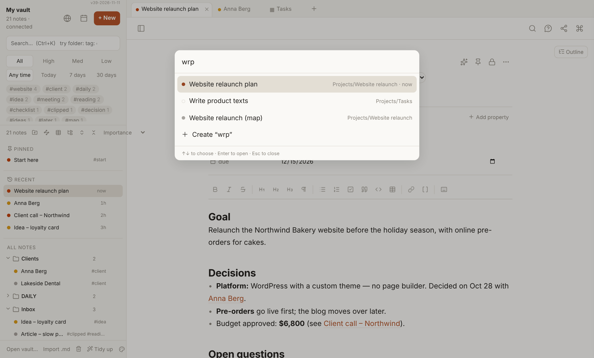

### Filters and sorting in the sidebar
- **Importance:** All / High / Med / Low.
- **Date:** Any time / Today / 7 days / 30 days (edited within).
- **Tags:** click one to filter, click again to stop.
- **Sort** (menu above the note list): Importance, Name A–Z, Name Z–A, Newest edited, Oldest edited, Last opened. Folders follow the same order.
- **Sort one folder differently:** right-click it → **Sort notes here…** Its sub-folders follow; a small ↕ shows it has its own order.
- **Recent:** your last opened notes, below Pinned. Hide or show it by right-clicking **All notes**.
- **Hover a note** to see its folder, when it was last edited, and when you last opened it. When sorted by date, rows show short dates ("10m", "2h", "Mon", "Oct 3").

---

## 6. The command palette

Press **Ctrl+Shift+A** (or **F1**, or the **⌘** button) and type what you want: *print*, *trash*, *new map*, *lock*, *sort newest*, *pdf*… Letters don't need to be complete: *nm* finds **New map**.

- **↑/↓** to choose, **Enter** to run, **Esc** to close.
- The commands you used last are at the top.
- Only commands that make sense right now are shown.
- Type part of a note's name and matching notes appear below the commands.

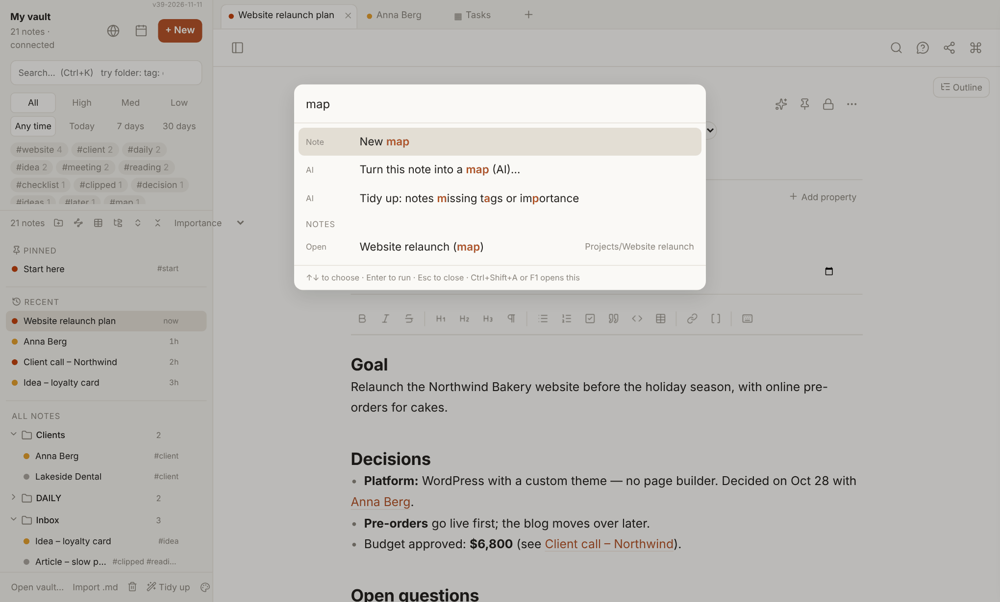

---

# Part 2 — More kinds of notes

## 7. Tables (like Notion)

Build a table from scratch and fill it in, as in Notion. Every **row is a normal note**, so a row can also hold a whole page of text.

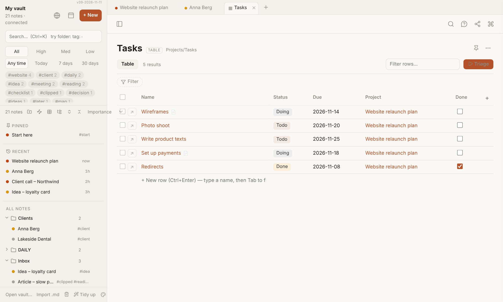

### Create a table
Click **table** above the note list, or right-click a folder → **New table here**, or use the command palette → *New table*. Give it a name and choose where to put it. You get an empty table with a **Name** column.

### Columns
Click **+** at the right end of the header row and choose a type:

- **Text**
- **Dropdown (one choice):** e.g. Todo / Doing / Done, shown as coloured labels
- **Dropdown (several choices):** tick as many as you like
- **Number**, **Date**, **Checkbox**
- **Tags:** any values, comma separated
- **Link to a note:** pick a note; click the link to open it
- **URL**

For the dropdown types, type the choices one per line (or with commas). You can add choices later from a cell (**+ New choice**) or from the column menu → **Type & choices…**

**Click a column title** to sort A→Z or Z→A, rename it, change its type or choices, move it left or right, hide it (the data stays), filter by it, or **delete it**. **Delete column…** removes the column from the table in all its views and, if you leave the box ticked, also removes its values from the row notes (old values stay in each note's version history). Untick the box to keep the values in the notes.

### Rows
- **Add a row:** **Ctrl+Enter** anywhere in the table, or type a name in **+ New row** under the table and press Enter. Press **Tab** instead of Enter to jump straight into the row's columns.
- New rows are added at the bottom in the order you add them. If you sort by a column, the table follows that sort; **Remove sorting** in the column menu brings back your own order.
- **Open a row as a page:** the small **↗** button at the start of the row.
- **Rename:** double-click the name. **Delete:** right-click the row → **Delete row** (it goes to the Trash).
- **Delete several rows at once:** tick the small boxes at the very left of the rows (**Shift+click** ticks a range; the box in the header ticks all rows shown). A bar appears above the table: **"3 selected · Delete · Clear selection"**. **Delete** asks once, then moves the notes to the Trash. This works in every table and Base.

### Typing in cells (like a spreadsheet)
- **Tab / Shift+Tab:** save and go to the next / previous column (continues on the next row).
- **Enter / Shift+Enter:** save and go down / up in the same column.
- **Esc:** cancel. On a checkbox, **Space** ticks it.
- In a **Dropdown (several choices)** cell: ↑/↓ and Space tick values; type a new choice at the bottom and press Enter.

### Send a note to a table

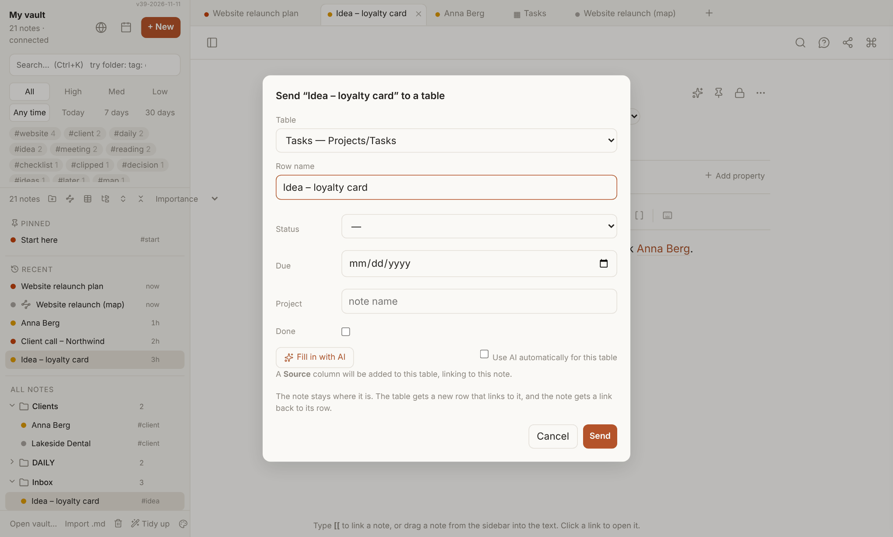
Any note can get a row in a table, **without moving the note**:
1. In the note, click the **table** button at the top (or right-click the note → **Send to a table…**, or pick a table directly from the list below it). The command palette has **Send this note to a table…** too.
2. Choose the table. The last one you used is already selected, so usually you just press **Send**.
3. A short form shows the table's columns, already filled in where possible: properties with the same name (importance, status…), the note's tags (also #tags in its text), a **title** column gets the note's first heading or its name, and a URL column gets the note's web link. Fill in or change the rest. You can also change the **row name**.
   - **✨ Fill in with AI** asks Claude to suggest the remaining values from the note: tags that match the ones already used in that table, a short title, values for the other columns. Suggested fields get a light outline; check them before sending. Only this one note is sent to Claude (about a cent).
   - Tick **Use AI automatically for this table** and the AI fills the form by itself every time you send to that table (remembered per table, on this PC).
4. The note's **other properties** are listed below: leave them in the note, **copy them as a new column**, or **copy them into** an existing column.

The table gets a new row whose **Source** column links to your note — shown as **Note: …** with a small note icon, so it stands apart from web links (tables without a Source column get one automatically). The note shows **In tables** under its tags: one chip per table — click it to open that table right at the note's row (it flashes briefly); **＋ table** sends the note to another table. A note can be in as many tables as you like; sending it to the same table again just opens the table.

### Filters and views
Click **Filter** above the table, or a column title → **Filter by this column…** Conditions depend on the column type: contains / is / is empty for text; =, >, < for numbers; before / after / in the last or next N days for dates; ticked / not ticked; *is any of* / *has all of* for dropdowns. Each filter shows as a chip; click it to change it, × removes it. All filters must match.

To keep a filter, use **Save as new view…** (e.g. *Open tasks*). It becomes a tab next to **Table**. **Save to "…"** stores filters in the current view; **Clear** / **Undo changes** throws unsaved changes away. Right-click a view tab to rename, duplicate or delete it.

### Peek at a row's page
- **📄** next to a name means that row's page has text (**🔒** = locked page).
- Rest the mouse on a name for half a second to see the first lines of its page.
- Name column title → **Show page text column** shows the start of each page in grey.

### How a table is stored
The table gets its own folder; every row is a `.md` note in it, with the cell values at the top of the file. The layout is a small `.base` file in the same folder. It's all plain files, so it syncs like everything else.

---

## 8. Bases (saved views of notes)

A **Base** shows existing notes as a table, chosen by a filter, for example "everything in Inbox". Bases made in Obsidian open in My Notes too. Switch views with the tabs, edit cells, sort, add columns with **+**, and use **+ New row** when the Base looks at a single folder, exactly as in a table.

---

## 9. Maps (mind maps and idea boards)

A map is a normal note shown as **cards and arrows**. Switch between **Text** and **Map** at the top of the note.

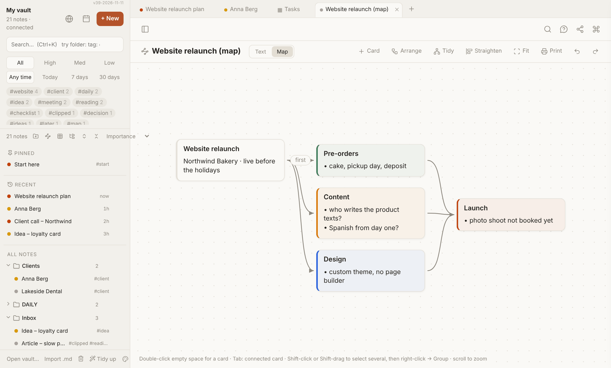

- **New map:** the **map** button above the note list, or right-click a folder → **New map here**.
- **Add a card:** double-click empty space, or **+ Card**. **Tab** adds a card connected to the selected one.
- **Connect two cards:** hover a card and drag the dot on its right edge onto another card. Click an arrow to **add a comment**, **reverse** or **delete** it.
- **Colours:** right-click a card → Decision (green), Question (yellow), Idea (blue), Risk (red), Done (grey).
- **Shapes:** right-click a card → **Shape…**: Rectangle, Rounded, Pill, Ellipse, Circle, Diamond, Hexagon, Sticky note. Works on several selected cards at once.
- **Note cards:** drag a note from the sidebar onto the map; double-click the card to open the note.
- **Select several:** Shift+click or Shift+drag. Right-click → **Group** puts them in a group.
- **Layout:** **Arrange** (Alt+L), **Tidy** (Alt+T), **Straighten** (Alt+S), **Fit** to see everything.
- **Edit / delete / undo:** Enter edits a card, Delete removes, Ctrl+Z / Ctrl+Y undo and redo. Scroll to zoom, drag empty space to move around.
- **Print:** the **Print** button offers **Fit on one page** or **Across several pages**.

**Maps are text underneath.** In Text view every `## Heading` is a card, the lines below it are its text, and a line like `→ Other card : label` is an arrow. A `#decision` (or `#question`, `#idea`, `#risk`, `#done`) after the heading sets the colour. You can write or fix a map by typing.

---

## 10. Graph

Click the **graph** button at the top, or use the command palette → *Graph*. Each **dot is a note** and each **line a link** between two notes. Bigger dots have more links; colours show the top-level folder (legend at the bottom).

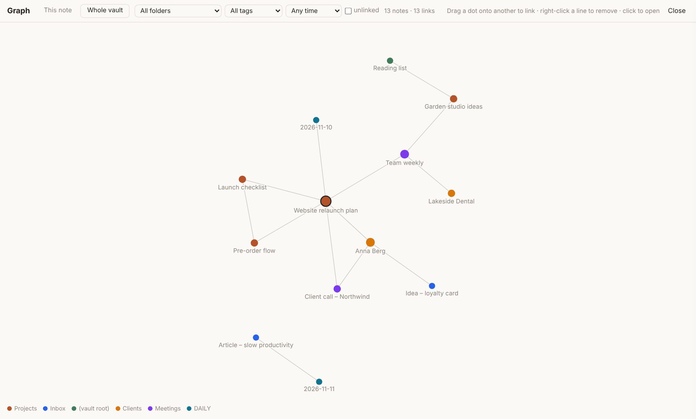

- **This note:** the open note in the middle, plus what it links to and what links to it, 1 or 2 **steps** out.
- **Whole vault:** filter by folder, tag or date; tick **unlinked** to also see notes without any links (good for finding forgotten notes).
- **Hover** a dot to highlight its neighbours; **click** to open the note; **Shift+click** centres the graph on it. Scroll to zoom, drag the background to move.
- **Link two notes:** drag one dot onto another and let go. The first note gets `Related: [[Other note]]` at its end.
- **Remove a link:** right-click a line → **Remove this link** (works for links added via *Related:*; for links inside the text it offers to open the note).
- Right-click a dot for **Open**, **Show this note's neighbours** or **Link to another note…**
- **Esc** closes the graph.

---

## 11. Daily notes and templates

- **Today's note:** the **calendar** button at the top of the sidebar, or **Ctrl+D**. Daily notes live in the folder **DAILY** and are named by date (e.g. `2026-11-11`).
- Arrows at the top of a daily note go to the previous or next day.
- **Template:** the first time, My Notes creates **TEMPLATES/Daily note**. Edit it to change what new daily notes look like. In templates you can use `{{date}}`, `{{date:dddd, D MMMM YYYY}}`, `{{time}}` and `{{title}}`.

---

## 12. Images, attachments and links to files

### Images
Paste a screenshot (**Ctrl+V**) or drop an image file into the text. It's saved in your **attachment folder** and shown in the note. To choose that folder: right-click a folder → **Save new images and attachments here** (to undo: **Stop saving new images and attachments here**).

### Files inside your vault
Drag a file from File Explorer onto the note text:
- a note becomes a `[[note]]` link
- an image is shown
- another file becomes a link like `[[Offer.pdf]]`. Clicking it opens PDFs, images, text and media in a new window, and downloads other files (Word, Excel…).

### Files anywhere on your PC (nothing is copied)
1. Select the file(s) in File Explorer and press **Ctrl+Shift+C** (*Copy as path*).
2. Press **Ctrl+V** in the note. Each path becomes a link with the file's name. Network paths (`\\server\share\…`) work too.
3. Clicking such a link copies the path. Press **Win+R**, then **Ctrl+V** and **Enter**, and Windows opens the file in its program.

Dropping a file from outside the vault doesn't copy it; you get the Ctrl+Shift+C tip instead.

> Why not open the file directly? Chrome doesn't let web apps open files on your disk by themselves. This is the safe way around it.

### Importing
**Import .md** (bottom left) copies Markdown files into the vault.

---

## 13. Web clipper

The **globe** button saves a web page as a note: paste the address, pick a folder, and My Notes stores the page's text with its source link. Right-click a folder → **Clip a web page into this folder…** does the same there. The clipper uses **Firecrawl**; the first time, you're asked for a Firecrawl API key, which is stored only on this PC.

---

# Part 3 — Keeping things safe

## 14. Locked notes

For passwords, keys and private notes.

- **Lock a note:** click the **lock** button at the top (or right-click the note → **Lock note…**). The first time, you choose a password. **It's one password for all locked notes, on all your PCs. If you forget it, locked notes can't be recovered.**
- The note's file is **encrypted** (AES-256) and the note closes. In Dropbox, Notepad or any other app it's unreadable; only its name is visible.
- Locked notes show an orange **lock** instead of the importance dot (closed = locked, open = open right now).
- **Open it:** type the password. It **locks again as soon as you switch to another note** or close its tab. Tick **Keep locked notes open for 5 minutes** to move between locked notes without retyping. Everything locks after 15 minutes without activity, or with **Lock all now**.
- **Remove the lock** or **Change lock password** from the lock button.
- AI features never see locked notes, and they can't be duplicated as plain text.
- Copies made *before* you locked a note (Dropbox's own file history, the Trash) stay readable, so lock new secrets right away.

---

## 15. Version history

Click the **clock** button at the top, or right-click a note → **Version history…**

- While you edit, a version is kept at most every 10 minutes, up to 50 per note. Versions are stored in the hidden `.history` folder in your vault, so they sync to your other PC too.
- Pick a version on the left. **Show changes** marks what's different from now (red = only in that version, green = only now). Untick it to read the whole old text.
- **Restore this version** puts it back. The current text is saved as a version first, so nothing is lost.
- Versions follow a note when you rename or move it. Locked notes keep only encrypted versions.

---

## 16. Trash

Deleted notes, tables and folders go to the vault's `.trash` folder, not away for good.

- Open it with the **trash icon** (bottom left), or right-click **All notes** → **Open trash…**
- Each item shows where it came from and when it was deleted.
- **Restore** puts it back in its original folder, re-creating the folder if needed.
- The red bin button deletes one item **permanently**; **Empty trash** deletes everything in it permanently. Both ask first.

---

# Part 4 — AI (optional)

## 17. Setting up AI, privacy and costs

The AI features work with **Claude** (Anthropic), **OpenAI** or **DeepSeek**: you choose. They're optional; everything else works without them.

**Setup:** open **AI settings**: the **robot icon** at the bottom left of the sidebar (next to the palette icon), the command palette (Ctrl+Shift+A) → *AI settings*, or right-click **✨** next to a note's title. The first time you use an AI feature, My Notes opens it for you.
1. **Which AI should My Notes use?** Pick Claude, OpenAI or DeepSeek.
2. Paste that provider's **API key** (add a little credit on its site first):
   - Claude: **console.anthropic.com** → API Keys
   - OpenAI: **platform.openai.com** → API keys
   - DeepSeek: **platform.deepseek.com** → API keys
3. Choose a **model**. The first one is **recommended** (good and cheap); the second is the **best quality** and costs more. **Show all models from your key…** lists every text model your key can use.
4. Click **Test**: it says ✓ or tells you what's wrong (wrong key, no credit, unknown model). Then **Save**.

Each provider keeps its own key, so you can switch any time without typing keys again. Keys are stored **only in this browser on this PC**.

| Provider | Recommended | Best quality | Web search in threads | Price (per million tokens, in / out) |
| --- | --- | --- | --- | --- |
| Claude | Haiku 5.5 | Sonnet 5.5 | ✓ | $1 / $5 · Sonnet $2 / $10 |
| OpenAI | GPT-6.1 Terra | GPT-6.1 Sol | ✓ | $1 / $5 · Sol $2 / $10 |
| DeepSeek | DeepSeek Flash | DeepSeek V4 Pro | — | about $0.30 / $1.20, half price off-peak |

DeepSeek is by far the cheapest, but it can't search the web and its servers are in China. Where this manual says **Claude**, read *the AI you chose*. Quick helper jobs (search words for *Ask your notes*, tag suggestions, table fields) always use the recommended model, even if you chose the best one.

**Privacy, in short:**
- Your notes are only sent to the AI you chose when you use an AI feature, and only what that feature needs (see each section).
- **Locked notes are never sent.**
- Nothing is sent to anyone else. My Notes has no server of its own.

**Costs** go to your account with that provider. Rough guide (Claude Haiku / GPT-6.1 Terra; DeepSeek costs much less): a suggestion or a selection question costs a fraction of a cent to about a cent; a thread reply roughly 1–5 cents (more as the thread gets longer, plus about 1 cent per web search); *Ask your notes* about 2–5 cents per question; turning a long note into a map a few cents.

---

## 18. Suggestions and Tidy up

### ✨ Suggestions for one note
Click **✨** at the top (or the **Suggest** hint next to the tags, or right-click a note → **Suggest tags & more**). Claude reads that one note and suggests **tags** (reusing your existing ones), **importance**, a better **folder**, and a short **summary**. Accept each suggestion separately, or **Accept all**. Nothing changes until you accept.

### Ask about the whole note
At the bottom of the Suggestions panel there's an **Ask** line, so you can do more with the note than tags and a summary:
1. Click one of **your AI buttons** (Explain, Summarize, Checklist, As email, → English…), or type any question and press Enter, e.g. "what are the open risks?" or "rewrite the summary for a client".
2. Choose what to do with the answer:
   - **Add at top** or **Add at end:** puts it in a coloured **AI box** (hide/show it like the other AI boxes).
   - **Replace note text:** only for buttons marked "replaces the text", such as Improve and the translations. Ctrl+Z undoes it, and Version history keeps the old text.
   - **New note:** saves the answer as a new note next to this one, with a link back.
   - **Copy** or **Discard**.
3. If you typed your own question, **☆ Save as button** keeps it as a button for next time.

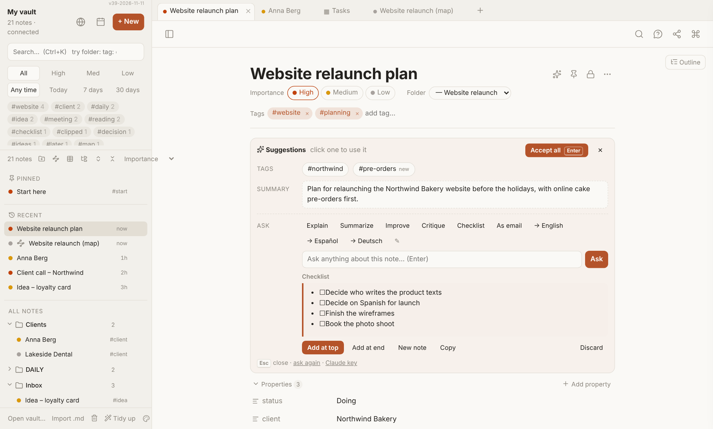

### My AI buttons
The buttons are one list, shared by the Suggestions panel and the panel for selected text, and by your PCs (it's stored in the vault's settings note). Click **✎** after the buttons (or the command palette: *My AI buttons*) to change them: rename, reword what Claude should do, tick **replaces the text** for rewrites and translations, move up/down, remove, **＋ Add button**, or **Reset to the standard buttons**.

### Tidy up: notes missing tags or importance
**Tidy up** (bottom left), or right-click a folder → **Tidy up: notes here missing tags or importance**. My Notes collects the notes that lack tags or importance and walks you through them one by one in **triage** mode, with ✨ suggestions ready.

### Triage mode
Right-click a folder → **Triage notes in this folder** works the same way for any folder, for example your Inbox. A bar at the top of the note gives single-key actions while you're not typing:

| Key | Action |
| --- | --- |
| J / K | Next / previous note |
| 1 / 2 / 3 / 0 | High / Medium / Low / no importance |
| T | Add a tag |
| M | Move to a folder |
| O | Open the note's web link (clippings) |
| D | Delete |
| E | Edit the text (Esc leaves the text again) |
| Enter | Accept the ✨ suggestions and go to the next note |
| X | Stop triage |

Checkbox properties get their own letter keys too; they're shown in the bar.

---

## 19. Ask your notes

Ask a question in normal words and get an answer **written from your own notes**, with links to the notes it used.

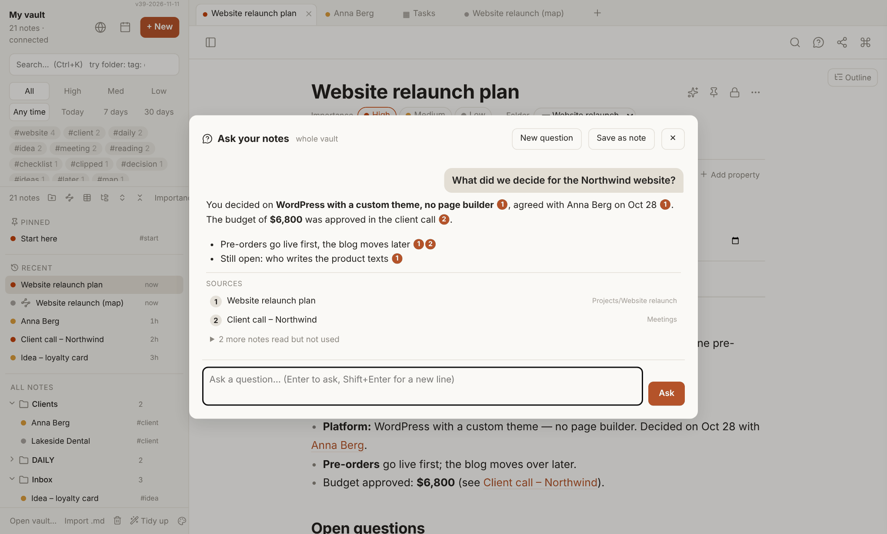

- Click **💬** at the top, press **Ctrl+J**, or right-click a folder → **Ask about the notes here…** (only that folder).
- Type your question in any language and press Enter, e.g. *"What did we decide for the Northwind website?"*
- The small numbers in the answer show which note each part came from. The **Sources** list opens those notes with one click. **… more notes read but not used** shows what else was looked at.
- **Follow-up questions** continue the conversation ("and the budget?"). **New question** starts over. Closing the window keeps the conversation until you start a new one.
- **Save as note** writes the questions and answers into a new note, with `[[links]]` to the sources.
- Narrow it down with the same words as in search: `folder:Clients`, `tag:website`, `edited:30d`.

**How it works:** Claude first turns your question into search words (including English, Spanish and German versions). My Notes then searches your vault **on your PC** and picks the best-fitting notes, up to 14 (long notes only in parts). Only those notes are sent to Claude, which answers from them alone. If the answer isn't in them, it says so instead of guessing; try other words or a folder.

---

## 20. AI on selected text and AI boxes

### Ask about a selection
1. **Select some text** in a note. A small round **✨** button appears next to it. Click it.
2. Type a question and press Enter, or click one of your AI buttons (**Explain**, **Summarize**, **Checklist**… change them with **✎**, see [My AI buttons](#my-ai-buttons)). Pressing **Ask** with nothing typed lets Claude respond to the text itself.
3. The popup closes and Claude answers **in the note**, in a **Thread** box right under your text. Continue there, see [Chat threads](#20-ai-on-selected-text-and-ai-boxes) below.
4. **Improve** and the translations (→ English…), the buttons marked *replaces the text*, put Claude's version **in place of** your text instead.

**Ctrl+Z** undoes it. Only the open note is sent to Claude; this is turned off for locked notes.

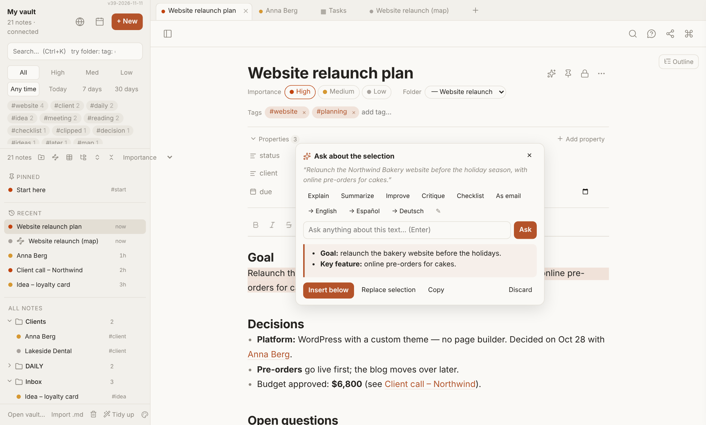

### AI boxes
An inserted answer looks like this: a box with a header such as **✨ AI · Summarize**, and above your text a thin line **"✦ Selected for AI · Summarize"** with a faint bar down the selected text, so you can see exactly what the box is about. If you selected only a few words, those words get a light highlight instead.

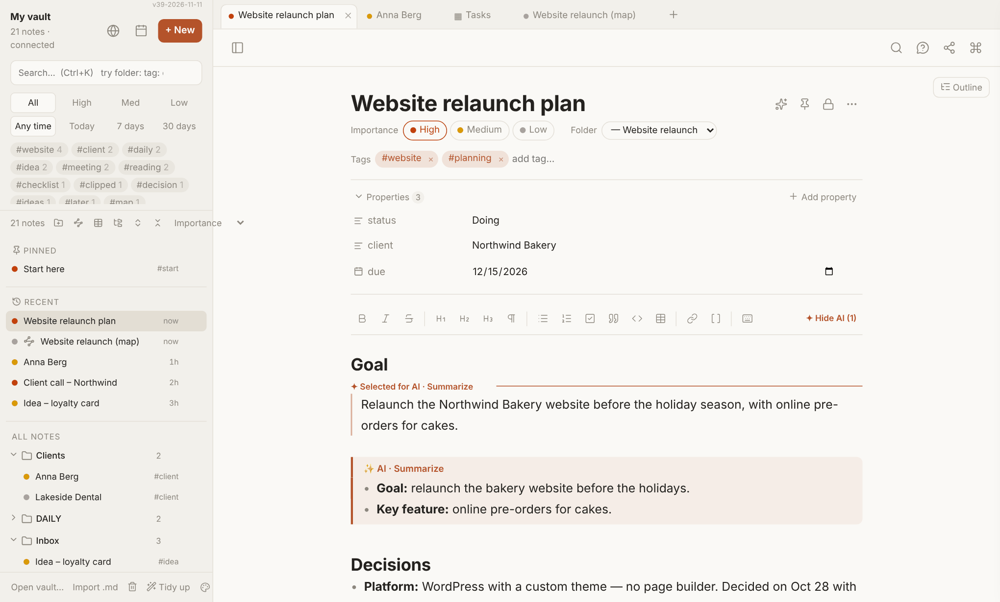

**Hide AI boxes:** when a note has AI boxes, a **✦ Hide AI (n)** button appears at the right end of the formatting bar. Hidden boxes shrink to a small **✦ AI · …** chip; click it (or **✦ Show AI**) to see them again. Nothing is deleted. This is remembered per note; the command palette also has **Hide AI boxes in all notes** / **Show AI boxes in all notes**.

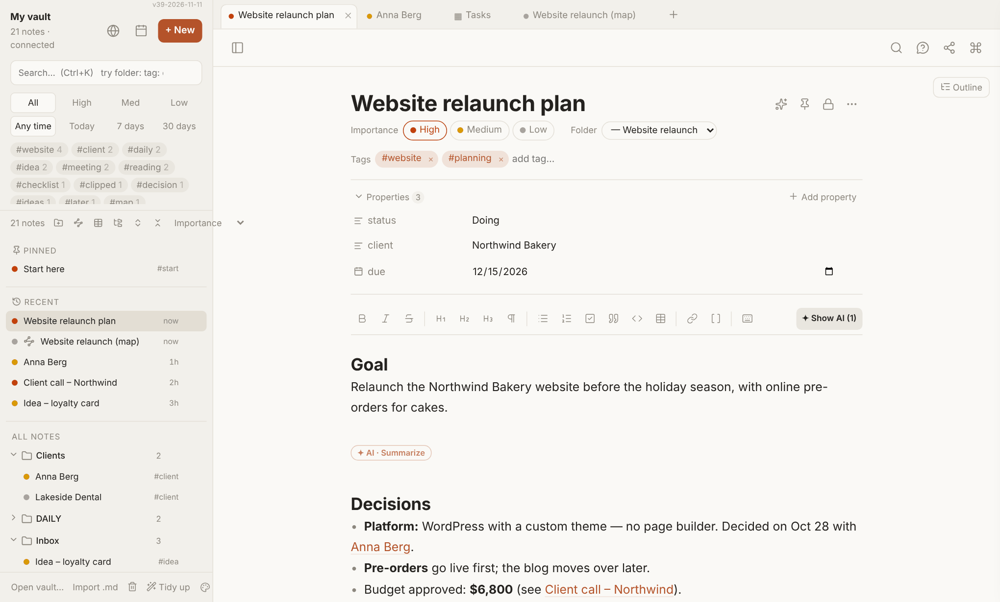

**Remove an AI box:** put the cursor inside it → command palette → **Remove the AI box at the cursor**. Its selection marker goes too.

**In the file**, an AI box is a standard Markdown callout (`> [!ai] Summarize` followed by lines starting with `>`), and the selection markers are hidden comments (`%% ai-start … %%`, `%%ai{%%…%%}%%`). Obsidian shows the box as a callout and hides the markers; printing shows the box and drops the markers.

### 💬 Chat threads
Have a conversation with Claude **inside the note**, starting from any text:

1. **Select** the text (for example "I want to plan a trip to Vienna, flying out from Querétaro"), click the **✨** that appears, type a question (or click an AI button, or just **Ask**) and press Enter.
2. Claude's answer appears in an AI box called **Thread** right under your text. If something important is missing, it asks a few questions first.
3. To continue, click **Reply** under the thread, type your answer or next question, and press Enter. Or **select any part of the thread** and click **✨** to ask about exactly that part ("about this route…").
4. Your line (**You: …**, shown indented to the right like a chat message) and Claude's answer are added to the **same box**, so the whole conversation stays together. Keep going as long as you like.

**Done?** Click **Summarize** under the thread. Claude writes a short **Summary of thread** box right under it (what was decided, the final plan or answer, open questions, next steps as checkboxes) and **folds** the thread into a small chip *✦ AI · Thread (n messages)*. Nothing is deleted: click the chip to open the thread again. If you continue the chat and summarize again, the old summary is replaced. **Fold** folds a thread without a summary.

The thread is saved in the note like any other text: come back tomorrow and reply again, edit or delete parts, or hide it with **✦ Hide AI**. If Claude can't answer (no connection, busy), a ⚠️ line appears in the thread; just reply again.

**Web search:** in threads, Claude can search the web when the answer depends on current facts (news, prices, products, opening times, rules, companies), and lists its **Sources** as links at the end of the answer. It uses the provider's own web search (Claude or OpenAI), so you don't need an extra account or key; it costs about 1 cent per search. **DeepSeek can't search the web**: the switch shows *No web search with DeepSeek*. In a thread, Claude reuses what it already found in earlier answers and only searches for what is new. Switch it off with **Search the web** in the ✨ popup. If web search is turned off for your key (some company accounts), you get a short notice and the answer comes without it. Claude can't book anything or see live booking-site fares.

**Cost of each answer:** every thread answer and summary ends with a small grey line like *Haiku 5.5 · Tokens: 3,400 in · 600 out · 2 web searches · cost $0.0254*: the model that answered, then the cost in USD at that model's prices (about $0.01 per web search). For a model whose price My Notes doesn't know, only the tokens are shown. Under the thread (below Reply / Summarize / Fold), a **thread total** adds up all these lines, including the summary's, and splits the cost by model when you used more than one AI; a folded thread shows its total in the chip. The total is only shown on screen, never saved in the note. If a very big request gets cut off, the thread says so; reply "continue" or ask for a smaller part.

**What Claude sees:** the note and the whole thread, every time. **Costs:** long threads use more tokens, roughly 1–5 cents per reply; the reply box reminds you. 

---

## 21. Turn a note into a map

Right-click any note → **Turn into a map (AI)…** Choose how detailed (compact, detailed, or everything important) and optionally a focus, such as "decisions and next steps". Claude builds a new map next to the note, named *"note (map)"*, with coloured cards, labelled arrows and groups, already arranged.

Your original note stays as it is; only one line is added at its end, `🗺 Map: [[note (map)]]`, and the map's central card links back.

---

# Part 5 — Everything else

## 22. Printing and PDF

- **Print:** **Ctrl+P** or the printer button. In the print window choose a printer or **Save as PDF**.
- **Save as PDF directly:** **Ctrl+Shift+P** or the **PDF** button. You choose where to save the file.
- **Maps:** the map's **Print** button offers **Fit on one page** or **Across several pages** (bigger and easier to read, with page numbers).

---

## 23. Using several PCs (Dropbox)

*Any sync service works the same way: Dropbox, OneDrive, Google Drive, iCloud Drive, Syncthing…*

- Put your vault in Dropbox (or OneDrive, Google Drive…) and set the folder to **Available offline**.
- On each PC, install My Notes and choose that folder once with **Open vault…**
- **Pins, icons, appearance, property types, saved searches** and other settings are stored in the vault in the hidden folder `.mynotes` (`.mynotes/settings.md`, with a backup `settings.backup.md` and a README), so every PC looks the same. Don't edit or delete that folder. If `settings.md` ever goes missing, My Notes restores it from the backup. (Before v56 the settings were in a folder called `My Notes`; v56 moves them by itself the first time it opens the vault. Update My Notes on all your PCs: an older version on another PC keeps writing to the old place — v56 picks those changes up, but only when it opens the vault.)
- Some things are kept **per PC**: the AI keys (Claude, OpenAI, DeepSeek), the Firecrawl key, your recently opened notes, and which AI boxes you've hidden.
- My Notes re-reads the vault when you come back to it after **2 minutes or more** in another window. To pick up changes right away, right-click **All notes** → **Check for changes on disk**.
- Try not to edit the same note on two PCs at the same moment. If it happens, Dropbox keeps a *conflicted copy*; compare the two and delete one.

---

## My Notes on your phone

*New in v41.* **My Notes Mobile** is a separate, simpler app for your phone at **https://rudivanek.github.io/My_Notes/m/**. It works on the same notes folder as the desktop app, but reaches it through **Dropbox**, because phones can't open a folder the way Chrome on a PC can. Your vault must be in Dropbox (see the section before this one).

**What it does:** recent notes (that's the start screen), pinned notes, folders, search (`tag:` and `folder:` work), tags, reading notes with links, backlinks, pictures and tappable checkboxes, writing and editing, a quick **+** for new notes, importance, tags and pin, and moving notes to the trash. **Maps** are shown as text: each `##` heading is a card and each `→` line an arrow, so you can read and edit them, but you only see the map itself on your computer. **Locked notes** can be read with your password, but not edited. Tables, the graph, AI, history and printing stay on the computer.

**Set it up (once, about 2 minutes):**
1. On the phone, open **https://rudivanek.github.io/My_Notes/m/** in Chrome.
2. Follow the steps on the screen: create a free Dropbox app at dropbox.com/developers/apps (**Scoped access**, **Full Dropbox**), tick the permissions `files.metadata.read`, `files.content.read`, `files.content.write`, add the redirect address the app shows you, and paste the **App key**. It's easier to do the Dropbox part on your PC and then paste the key on the phone.
3. Tap **Connect Dropbox**, allow access, then open your notes folder (for example *MyNotes → RFV_Vault*) and tap **Use this folder**. The first sync downloads all notes, which can take a minute.
4. In Chrome's menu, tap **Add to Home screen** / **Install app**. Now My Notes opens like an app and works offline.

**Sharing into My Notes (Android):** once it's installed, My Notes shows up in Android's **Share** menu. Share a tweet, a link or some text to it, and a new note opens with the text and link filled in. Tap **Save** and it goes to your **Inbox** folder. You can choose another folder for new notes in **Settings**.

**How syncing works:**
- Notes are kept on the phone, so the app opens at once and works without internet. Changes are sent to Dropbox when you're online (the cloud icon at the top shows a number while changes are waiting). It syncs when you open the app, every 1½ minutes while it's open, or when you tap the cloud icon.
- Your PC gets the changes through the Dropbox app as usual, and My Notes on the PC picks them up.
- If a note was changed on the PC **and** on the phone before they synced, nothing is lost: the PC version stays, and your phone version is saved next to it as **"Name (phone copy date time)"**.
- Before the phone saves over a note, the old version goes into **Version history** (at most every 10 minutes per note), just like on the PC.
- Notes deleted on the phone go to the vault's **.trash**, and the PC's **Trash** can restore them.
- The app only changes the lines it has to. Opening and closing a note without typing doesn't touch the file.

**Good to know:** pins, icons and other settings in `.mynotes/settings.md` aren't used on the phone. The phone uses the **pinned** property in the note's header (the pin button next to a note's title on the PC does the same). Links to files on your PC (`D:\…`) don't open on the phone. **Settings → Disconnect Dropbox** signs the phone out and deletes the notes stored on it.

---

## 24. Windows: opening .md files and quick capture

These work when My Notes is installed as an app (Option A or B). They are made for Windows; on a Mac some of them may work too.

### Open .md files with My Notes
Right-click any `.md` file → **Open with** → **Choose another app** → **My Notes** → **Always**.
- A file **inside your vault** opens as that note.
- A file **outside your vault** opens under **Opened files** in the sidebar. Edits are saved straight to that file; closing it never deletes the file.

### Quick capture from the taskbar
Right-click the **My Notes** icon in the taskbar or Start menu:
- **New note:** a fresh note, ready to type
- **Today's note:** today's daily note
- **Search notes:** straight to the search box

Tip: pin My Notes to the taskbar so this is always one click away.

---

## 25. Appearance

Open the **Appearance** panel with the palette icon at the bottom left, or **Ctrl+,**

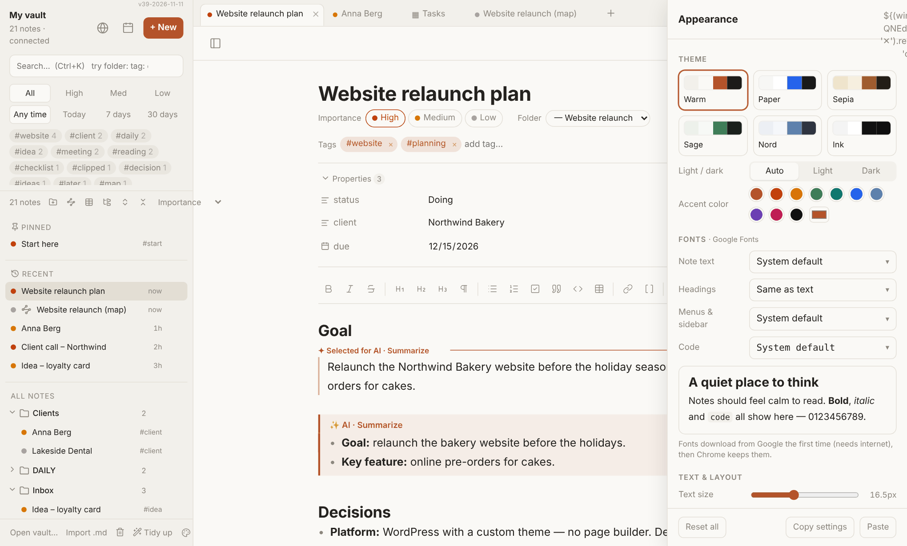

- **Theme:** Warm, Paper, Sepia, Sage, Nord or Ink, each in **light** and **dark**. **Auto** follows Windows.
- **Accent colour** for buttons, links and highlights.
- **Fonts:** any Google Font for note text, headings, menus and code (downloaded once, then kept).
- **Custom colours** for the page, sidebar and text, if the themes aren't enough.
- **Text and layout:** text size, line spacing, page width, heading size, weight and colour; sidebar width and size.
- **Map cards:** new card width, card font, text and title size, inner space, corners, lines shown, shadow, arrow thickness and arrange spacing.
- **Copy settings** / **Paste** to move a look between PCs or share it; **Reset all** goes back to the defaults.

Changes apply immediately and sync to your other PCs through the vault.

---

## 26. Keyboard shortcuts

### Anywhere

| Shortcut | Does |
| --- | --- |
| Ctrl+Shift+A or F1 | Command palette (every action) |
| Ctrl+K | Search |
| Ctrl+O | Jump to a note by name |
| Ctrl+J | Ask your notes (AI) |
| Ctrl+Alt+N | New note |
| Ctrl+D | Today's daily note |
| Ctrl+\\ | Hide / show the sidebar |
| Alt+← / Alt+→ | Previous / next tab |
| Ctrl+W or Alt+W | Close tab |
| Ctrl+Shift+T | Reopen a closed tab |
| Ctrl+P | Print |
| Ctrl+Shift+P | Save as PDF |
| Ctrl+, | Appearance |
| Esc | Close the open window or menu |

### While writing

| Shortcut | Does |
| --- | --- |
| Ctrl+B / Ctrl+I / Ctrl+Shift+X | Bold / italic / strikethrough |
| Ctrl+E | Code |
| Ctrl+K | Web link |
| `[[` or Ctrl+Shift+K | Link a note |
| Ctrl+Shift+V | Paste as plain text |
| Ctrl+Alt+1 / 2 / 3 / 0 | Heading 1 / 2 / 3 / normal text |
| Ctrl+Shift+8 / 7 / 9 | Bullet list / numbered list / checkbox |
| Ctrl+Shift+. | Quote |
| Ctrl+Alt+T | Table |
| Ctrl+Z / Ctrl+Y | Undo / redo |

### In the search box

| Shortcut | Does |
| --- | --- |
| ↓ / ↑ | Move through results |
| Enter | Open |
| Ctrl+Enter | Open and stay in the search |
| Esc | Clear the search, back to the note |

### In a table

| Shortcut | Does |
| --- | --- |
| Ctrl+Enter | New row |
| Tab / Shift+Tab | Next / previous column |
| Enter / Shift+Enter | Down / up in the same column |
| Space | Tick a checkbox |
| Esc | Cancel editing |

### In a map

| Shortcut | Does |
| --- | --- |
| Tab | New connected card |
| Enter | Edit the selected card |
| Delete | Delete the selected card or arrow |
| Ctrl+Z / Ctrl+Y | Undo / redo |
| Alt+L / Alt+T / Alt+S | Arrange / Tidy / Straighten |
| Esc | Clear the selection |

---

## 27. Right-click menus

Much of My Notes lives in right-click menus.

**A note** (in the sidebar): Open · Suggest tags & more (AI) · Rename… · Pin / Unpin · Change icon… · Move to folder… · Duplicate · Turn into a map (AI)… · Lock note… · Version history… · Print… · Save as PDF… · Copy link · Delete

**A folder:** New note here · New folder inside… · Rename folder… · Move folder to… · Ask about the notes here… (AI) · Pin · Change icon… · Clip a web page into this folder… · New map here · New table here · Sort notes here… · Save new images and attachments here · Tidy up: notes here missing tags or importance · Remove empty "Untitled" notes here… · Triage notes in this folder · Expand / Collapse everything inside · Delete folder

**"All notes" title:** New note · New folder… · Check for changes on disk · Expand / Collapse all folders · Show / Hide the Recent section · Remove empty "Untitled" notes… · Open trash… · Change lock password… · Lock all locked notes now

**A tab:** Close · Close other tabs · Close tabs to the right · Pin / Unpin · Change icon… · Delete

**A table or Base:** Open · Rename… · Change icon… · Pin · Delete. Inside a table: right-click a **row** (Open / Delete row) or a **view tab** (Rename / Duplicate / Delete view).

**The ✨ button:** AI settings (provider, key, model) or remove the key.

**In a map:** right-click a **card** (colour, shape, group, delete…), an **arrow** (comment, reverse, delete) or empty space.

**In the graph:** right-click a **dot** (Open, Show neighbours, Link to another note…) or a **line** (Remove this link).

---

## 28. Where your data lives

Everything is ordinary files in your vault. Nothing is hidden in a database.

| What | Where |
| --- | --- |
| Notes | `.md` files in your folders |
| Note settings (tags, importance, properties, pinned) | at the top of each note file (YAML front matter) |
| Tables and Bases | a `.base` file plus one `.md` note per row |
| Maps | normal `.md` notes with `type: map` |
| Images and attachments | your attachment folder (or the vault root) |
| Settings shared between your PCs (pins, icons, look, saved searches…) | `.mynotes/settings.md` (backup: `.mynotes/settings.backup.md`) |
| Version history | `.history/` (hidden) |
| Trash | `.trash/` (hidden) |
| AI keys (Claude / OpenAI / DeepSeek), Firecrawl key, recently opened, hidden AI boxes | only in Chrome on this PC |
| Quick-start copy of your notes (locked notes stay locked) | only in Chrome on this PC; rebuilt by itself |

Folders that start with a dot (`.history`, `.trash`, `.obsidian`) don't show up in the sidebar. My Notes doesn't need Obsidian, but your vault stays compatible with it.

---

## 29. Troubleshooting and questions

**My Notes asks for permission to my vault again.** Chrome does that sometimes after a restart. Click and allow; choose *Allow on every visit* if offered.

**A change from my other PC doesn't show up.** Wait until Dropbox has synced, then right-click **All notes** → **Check for changes on disk**.

**I see a "(my version)" note.** The note was changed elsewhere while you had unsaved edits. Both versions are kept; compare them, keep what you need, delete the other.

**The update didn't arrive.** Online (Option A): close My Notes completely and open it again while online. App folder (Option B): start the server again (`.bat`, `.command` or `.sh`) and open My Notes while its window is open. Check the version number at the top right of the sidebar.

**AI says my key isn't accepted, or I'm out of credit.** Open **AI settings** (right-click **✨** next to a note's title, or the command palette) and click **Test** next to the key: it says what's wrong. Add credit on the provider's site (console.anthropic.com, platform.openai.com or platform.deepseek.com). OpenAI sometimes reports a wrong key as "No connection"; Test shows it too.

**Ask your notes didn't find something I know is there.** Try other words (the actual words in the note), add `folder:…`, or make sure the note isn't locked.

**Clicking a link to a file on my PC doesn't open it.** That's expected: a browser app may not open files outside the vault, so the path is copied instead. On Windows press Win+R, Ctrl+V, Enter.

**Is anything uploaded?** No, except what an AI feature sends to the AI you chose in AI settings (or the web clipper to Firecrawl) when you use it. My Notes has no server and no account.

**Can I use it without Chrome?** Microsoft Edge works the same way. (Other Chromium browsers may work too; Brave, for example, needs this feature switched on first.) Firefox and Safari don't allow web apps to edit folders on your disk, so there it only runs as a demo.

**Does it work on a phone or tablet?** Not really: mobile browsers can't open a folder. Use a computer.

**I found a bug or have an idea.** Open an issue on GitHub: https://github.com/rudivanek/My_Notes/issues

**Can I go back to Obsidian?** Yes. The vault is plain Markdown; Obsidian opens it as before.
